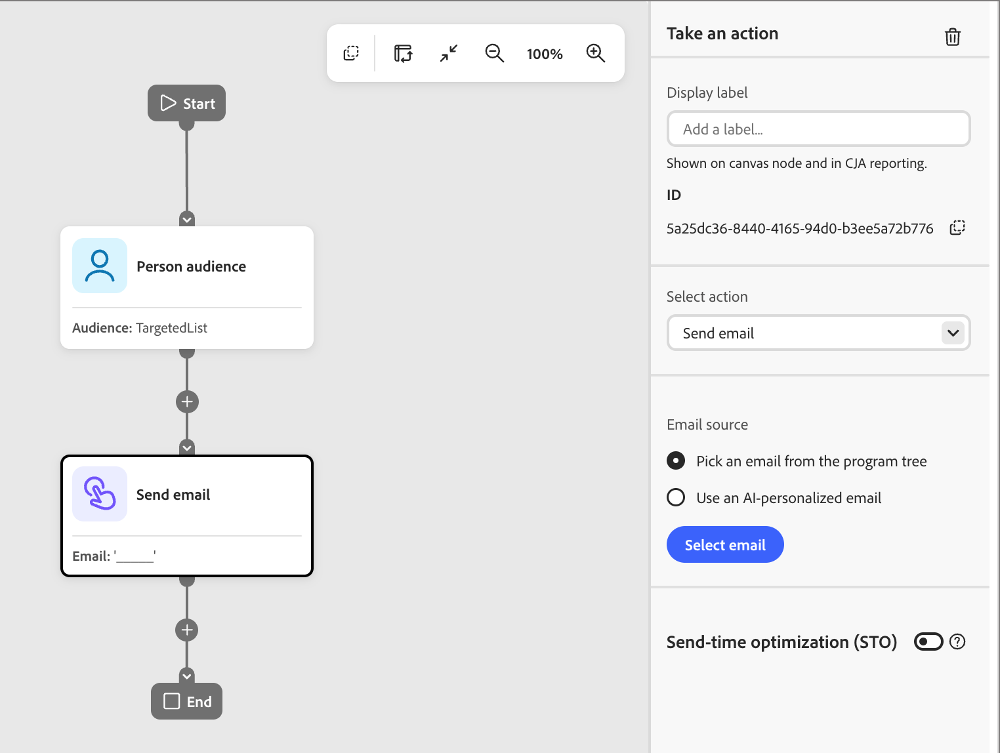
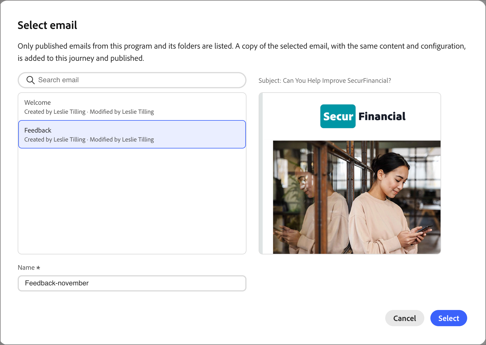
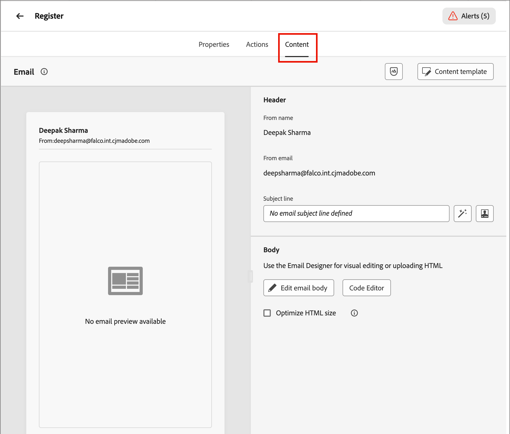

# Create emails and add them to journeys

[!DNL Adobe Marketo Optimizer] brings a modern, enterprise-grade email authoring and delivery experience to B2B marketers, so you can create, publish, and send emails from your programs and journeys.

Emails are standalone assets, so you don't need a journey to create one. [Create an email](#create-email-from-programs) inside a program or one of its folders, [publish it](#publish-email) when it's ready, and then [send it from any journey in that program](#add-email-from-journey).

## Email lifecycle {#lifecycle}

An email is always in one of the following states:

| State | Description |
| ----- | ----------- |
| **Draft** | Every new email starts as a draft, which is shown with a red envelope icon in the programs tree. You can edit its properties, actions, and content, and you can personalize, analyze, rename, or delete it. |
| **Published** | A published email is locked and ready to send, and it is shown with a green envelope icon. It can't be edited or unpublished, and it is listed when you pick an email in a journey. |
| **In a journey** | When you select a published email in a _Send email_ action, a published copy that belongs to the journey is created. The copy is read-only and doesn't change if the original is later duplicated and revised. |

An email moves from draft to published when you publish it. When selected for a _Send email_ action node, a copy resides in the journey. To change a published email, [duplicate it](#duplicate-email). The duplicate is created as a draft with the same content and settings.

The email state determines action availability:

| Action | Draft | Published | In a journey |
| ------ | ----- | --------- | ------------ |
| Edit properties, actions, and content | Yes | No | No |
| Personalize email | Yes | No | No |
| Analyze email | Yes | No | No |
| Publish | Yes, once blocking alerts are resolved | Already published | Published automatically |
| Duplicate | Yes | Yes | No |
| Rename | Yes | No | No. You name the copy when you select it. |
| Delete | Yes | No | No. Delete the _Send email_ node instead. |
| Select in a journey | No | Yes | Not applicable |

## Before you begin {#before-you-begin}

* Emails reside in a program or one of its folders. Define the program before you create an email. A journey can only send emails from its own program.
* To select an email channel configuration, use the email **[!UICONTROL Actions]** tab. Administrators manage [email channel configuration](../admin/email-channel-configuration.md).
* You can create as many emails as you need within a program.

>[!NOTE]
>
>If you are sending an email for the first time, make sure that [email deliverability](../start/email-deliverability.md) and the needed [email channel](../admin/email-channel-configuration.md) are configured.

<!-- 
* **Email channel configurations** - Manage the sender identity, reply behavior, marketing vs. transactional message types, and tracking.
* **Email deliverability controls** - Set up your email deliverability channel, including subdomain delegation (Fully Delegated and CNAME methods), DMARC, SPF/DKIM auto-configuration, and shared IP pool support.
* **Send Email action** - From a journey, add a _Send email_ action node, including personalization using profile attributes (Handlebars syntax).
* **Visual drag-and-drop email design tools** -  Design your email content with structures, content components, themes, dark-mode support, and reusable visual fragments.
* **Marketo Design Studio assets** — Choose images and assets from a one-time copy of your Marketo Engage asset library directly inside the email canvas.
* **Reusable templates and fragments** — Save common headers, footers, CTAs, and full email layouts and reuse them across journeys.
* **Role-Based Access Control (RBAC)** — Apply granular permissions for creating, editing, approving, and sending email. 
-->

## Current limitations {#limitations}

* **Test profiles, Simulate Content, and Send Proof** are not available in the current release. Litmus rendering and SpamAssassin-based spam reports are planned for a future release.
* **Account-level personalization and custom-object data** are not available in the current release. Use profile attributes.
* **Velocity-to-Handlebars automated migration** of existing [!DNL Marketo Engage] templates is available upon request.
* **Email comments and collaboration** (inline comments, @mentions, request-review workflow) are planned for a future release.
* **AEM Assets, AEM Content Fragments, and Adobe Express** integrations are planned for a future release.

## Key concepts {#key-concepts}

Before creating emails for person journeys and authoring email content, review these concepts:

| Concept | In [!DNL Adobe Marketo Optimizer] |
| ------- | ---------------------- |
| **_Email design space_** | The visual canvas and design tools used to compose email content. It includes drag-and-drop layout components, templates, fragments, themes, and a personalization editor. |
| **_Template_** | A reusable email layout that is available for creating a new email. It can be either a built-in sample template provided by Adobe or a custom-built template created by your team. |
| **_Visual fragment_** | A reusable block of content (such as a header, footer, CTA, legal disclaimer) that can be inserted into multiple emails. Updating a fragment propagates the change to every email that uses it. |
| **_Theme_** | A reusable styling preset (colors, typography, spacing, button styles) applied across an email. |
| **_Personalization token_** | A Handlebars expression — for example, `{{profile.firstName}}` — resolved at send time using each recipient's profile data. |
| **_Standalone email_** | An email asset that exists independently of any journey. It is created in a program or one of its folders, and it moves from draft to published. See [Email lifecycle](#lifecycle). |
| **_Email type_** | The classification you choose when you create an email, **[!UICONTROL Marketing]** or **[!UICONTROL Transactional]**. It tells [!DNL Marketo Optimizer] how to treat the message for consent purposes. See [Email types](#email-types). |
| **_Send Email action_** | The journey action node that uses a channel configuration and email content to deliver an email. |

## Email types {#email-types}

When you create an email, you choose its type. The type tells [!DNL Marketo Optimizer] how to treat the message for consent purposes, so choose the one that matches why you're sending it.

| Type | Use for |
| ---- | ------- |
| **[!UICONTROL Marketing]** | Promotional messages, such as a product launch announcement, a newsletter, or an event invitation. |
| **[!UICONTROL Transactional]** | Operational messages that a person expects because of something they did, such as an order, registration, or shipment confirmation. |

The type appears as the email **[!UICONTROL Category]** on the **[!UICONTROL Properties]** tab.

## Create an email in the programs tree {#create-email-from-programs}

Create an email in a program or folder to build it independently of any journey.

1. On the left navigation, expand **[!UICONTROL Marketing Management]** and select **[!UICONTROL Programs]**.

1. In the programs tree, click the _More_ icon (**...**) next to the program or folder where you want to create the email, and select **[!UICONTROL Create email]**.

   {width="400"}

1. In the _[!UICONTROL Create email]_ dialog, complete the following fields:

   * **[!UICONTROL Parent]** - (Required) The program or folder where the email is saved. It is set to the program you started from, and you can change it to another program or to one of the program's folders.

   * **[!UICONTROL Email type]** - Select **[!UICONTROL Marketing]** or **[!UICONTROL Transactional]** (see [Email types](#email-types)).

   * **[!UICONTROL Name]** - (Required) Enter a name that identifies the email in the programs tree.

   * **[!UICONTROL Description]** - (Optional) Enter a note for your team about the email and its purpose.

   {width="400"}

1. Click **[!UICONTROL Create]**.

The email opens in its own tab and appears under the program in the programs tree as a draft. While an email is open, any [!DNL Coworker] prompts are scoped to that email.

Next, [set up the email](#define-email-properties), [resolve any alerts](#alerts), and [publish it](#publish-email).

## Manage emails in the programs tree {#manage-emails}

Emails appear in the programs tree with an envelope icon. A red envelope marks a draft. A green envelope marks a published email, including the copies that live under journeys. Click the _More_ icon (**...**) next to an email to manage it.

{width="400"}

The menu for a draft email includes **[!UICONTROL Publish]**, **[!UICONTROL Personalize email]**, **[!UICONTROL Analyze email]**, **[!UICONTROL Duplicate]**, **[!UICONTROL Rename]**, and **[!UICONTROL Delete]**.

For a published email, **[!UICONTROL Duplicate]** is the only option.

### Personalize and analyze an email {#personalize-analyze}

While an email is a draft, its _More_ menu includes two content tools. Run them before you publish, because a published email can't be changed.

* **[!UICONTROL Personalize email]** - Opens [!DNL Coworker] with the email loaded. To add personalized content to the email, describe the target group. See [_Personalize email content by persona_](../agents/personalize-content.md) for more information.

   {width="700" zoomable="yes"}

* **[!UICONTROL Analyze email]** - Reviews the content that you already created. See [Analyze an existing email](../agents/personalize-content.md#analyze-existing-email).

### Publish an email {#publish-email}

Publish an email when it is ready to send. Only published emails are listed when you [select an email in a journey](#add-email-from-journey).

1. Make sure that the email has no blocking [alerts](#alerts).

1. In the programs tree, click the _More_ icon (**...**) next to the email and select **[!UICONTROL Publish]**.

1. In the _[!UICONTROL Publish email]_ confirmation dialog, click **[!UICONTROL Publish]**.

   {width="400"}

The email icon turns green. If you select the email, it opens in a read-only view that summarizes its content, properties, and actions.

{width="700" zoomable="yes"}

>[!IMPORTANT]
>
>Publishing is permanent. A published email cannot be edited, renamed, deleted, or returned to draft. To make changes, [duplicate the email](#duplicate-email).

### Duplicate an email {#duplicate-email}

To change a published email, duplicate it. To try a variation without changing the original, you can also duplicate a draft.

1. In the programs tree, click the _More_ icon (**...**) next to the email and select **[!UICONTROL Duplicate]**.

1. In the _[!UICONTROL Duplicate email]_ dialog, change the **[!UICONTROL Name]** if needed.

   It defaults to the original name followed by `_copy`. Optionally, add a **[!UICONTROL Description]**.

   {width="400"}

1. Click **[!UICONTROL Duplicate]**.

The duplicate is created as a draft with the same content and settings. Make your changes, and then publish it.

## Add an email from a journey {#add-email-from-journey}

To send an email, add it to a journey in the same program. When you select an email, [!DNL Marketo Optimizer] makes a copy of it for that journey and publishes the copy automatically. Emails come from the programs tree, so [create and publish the email](#create-email-from-programs) first.

You can use the same email in more than one journey. Each time you select it, a separate copy is created for that journey, and you can give each copy a unique name.

### Select an email for a Send email action {#select-email-in-journey}

1. Open the journey, and select or add a [_Take an action_ node](action-nodes.md#add-an-action-node).

1. In _[!UICONTROL Select action]_, choose **[!UICONTROL Send email]**.

1. Under _[!UICONTROL Email source]_, choose one of the following:

   * **[!UICONTROL Pick an email from the program tree]** - Choose this option to use a published email from the journey's program or its folders.

   * **[!UICONTROL Use an AI-personalized email]** - Choose this option to use an AI-generated email. These emails are optimized so that AI-assisted inbox clients ground their summaries and answers in your offers and calls to action.

   {width="600"}

   The node shows a blank email name until you choose an email.

1. Click **[!UICONTROL Select email]**.

   * **_Program tree email:_** In the _[!UICONTROL Select email]_ dialog, find and select the email.

      Use **[!UICONTROL Search email]** to filter if needed. Select an email in the list to preview it and check the subject line.

      {width="600" zoomable="yes"}

      >[!NOTE]
      >
      >The dialog lists only published emails from the journey program and its folders. Drafts do not appear until you [publish them](#publish-email). If an email does not appear, check that it has a published (green icon) and that it is located in the right program.

      In **[!UICONTROL Name]**, enter the name that the email should have inside the journey.

      It defaults to the original name followed by `_copy`. Rename it to something that makes sense in the context of the journey.

   * **_AI-personalized email:_** In the _[!UICONTROL Select an AI-generated email]_ dialog, find and select the personalized email.

      Select a personalized email from the list. The dialog lists the _AI-personalized emails_ stored in the AI Library. For more information, see Personalize email content by persona.

      {width="450" zoomable="yes"}      

1. Click **[!UICONTROL Select]**.

### Journey email copy {#journey-copy}

The copy is added to the journey, published, and listed under the journey in the programs tree. It has its own Action ID and is read-only.

{width="700" zoomable="yes"}

The journey keeps its own copy. Content and configuration are copied at the moment that you select the email. If you later duplicate and revise the original, existing journeys continue to send the copied version.

For optional [send-time optimization](email-send-time-optimization.md), configure the journey action node after you select the email.

### Update an email in a journey {#update-email-in-journey}

Because the journey's copy is read-only, you replace it rather than edit it.

1. [Duplicate](#duplicate-email) the original published email, make your changes to the draft, and [publish it](#publish-email).

1. In the journey, select the _Send email_ node and delete it by using the trash icon in the _Take an action_ panel.

1. Add a new _Send email_ action in its place and select the updated email.

## Define email properties and actions {#define-email-properties}

A draft email has three tabs: **[!UICONTROL Properties]**, **[!UICONTROL Actions]**, and **[!UICONTROL Content]**. Work through them in order, and then save your changes. The email page opens when you create an email in the programs tree. To open a draft later, select the email in the programs tree.

### Complete the Properties and Actions tabs {#properties-actions-tabs}

1. (Optional) In the **[!UICONTROL Properties]** tab, enter a **[!UICONTROL Description]** and any other descriptive information that you want to capture for the email.

   {width="800" zoomable="yes"}

1. Select the **[!UICONTROL Actions]** tab and complete the functional settings for the email:

   * **[!UICONTROL Email]** - Select or create an **[!UICONTROL Email channel configuration]** to use. 
   
      This is the reusable set of email-delivery settings that defines the sender identity, reply-to address, subdomain, IP pool, email type (marketing or transactional), and tracking. Click the _View_ icon to review the settings for the selected configuration.

      Administrators create configurations in [Email channel configuration](../admin/email-channel-configuration.md).

   * **[!UICONTROL Business rules]** - (Optional) Apply capping or quiet hours rules to your email action by selecting a rule set.
    
      For more information about business rules and how to define and activate rule sets for channel communications, see [_Business rules_](../admin/business-rules.md). 

   * **[!UICONTROL Action tracking]** - Select the check boxes for the actions that you want to track for the email.

   {width="600" zoomable="yes"} 

### Add the subject line and content {#content-tab}

1. Click **[!UICONTROL Edit content]**, or select the **[!UICONTROL Content]** tab. 

   {width="500" zoomable="yes"}

1. Enter the **[!UICONTROL Subject line]** text that you want to display in the subject field for the email.

   The subject line is required.

   Click the _Personalize_ icon (  ) to use a personalization token in the field.

1. (Optional) Select the **[!UICONTROL Optimize HTML size]** check box to reduce the size of your email HTML during the publishing process.

   This helps prevent email clipping in clients such as Gmail. Gmail truncates messages exceeding 100 KB. See [_Optimize email HTML size_](#optimize-html-size) for more information.

1. Click **[!UICONTROL Edit email body]** to access the visual design tools and start [building your content](../content/email-authoring.md).

   Alternatively, you can click **[!UICONTROL Code Editor]** to code your own content in plain HTML. If you have existing HTML to reuse for your email design, you can copy and paste it into the editor.

### Check alerts {#alerts}

The **[!UICONTROL Alerts]** button in the email header shows how many issues [!DNL Adobe Marketo Optimizer] has found. Click it to display the list.

{width="450"}

Alerts come in two kinds:

* **Blocking issues** - While any of these issues remain, **[!UICONTROL Publish]** is unavailable, and the email's _More_ menu shows **[!UICONTROL Resolve email alerts to publish]**. Resolve all blocking issues before you publish the email.

   Examples include:

   * From name is empty
   * Subject line is missing
   * Email content is empty

* **Warnings** - These point out things worth reviewing but don't prevent you from publishing. An email can show an alert and still be published if the remaining alerts are warnings.

   Examples include:

   * Opt-out link is not present in the email body
   * Text version of HTML is empty
   * Empty links detected
   * Email exceeds 100 K

## Optimize email HTML size {#optimize-html-size}

>[!CONTEXTUALHELP]
>id="ajo-b2b-prime_email_minification"
>title="Reduce HTML size"
>abstract="Enable this option to compress your email HTML during publishing by removing unnecessary whitespace, indentation, and non-essential comments. This helps prevent email clipping in clients such as Gmail. Gmail truncates messages exceeding 100 KB."

[!DNL Marketo Optimizer] allows you to compress your email HTML version during the publishing process by removing unnecessary whitespace, indentation, and non-essential comments. Keeping HTML size small helps you:

* Avoid **email clipping** — some clients such as Gmail truncate messages larger than ~100 KB, preventing recipients from viewing the full content.
* Improve **email load time** in the recipient's inbox.
* Improve **deliverability** and reduce bandwidth usage.

This optimization is not applied automatically — you must enable it in the _[!UICONTROL Content]_ tab.

<!--  -->

>[!IMPORTANT]
>
> The HTML size reduction is only applied at publication time.

The optimization is email-client safe:

* It preserves MSO/Outlook conditional comments.
* It does not alter your actual content, images, or videos.

>[!NOTE]
>
>The reduction in email size depends on the original HTML structure of your email. If the content is already compact or the email payload is very large, the reduction may be minimal and may not fully prevent clipping.

<!-- 
Proof and simulate workflows are not available in this release. See [Current limitations](#limitations).

### Test HTML size optimization {#optimize-html-proof}

If you have enabled the [HTML size optimization](#optimize-html-size) option, you can evaluate its impact before publishing when sending proofs. Follow the following steps.

1. In the email design space, click the _Issues_ icon on the top right. If the rendered email size exceeds 100 KB, a message is displayed to warn you that this may cause truncation in some email clients.

1. Click **[!UICONTROL Simulate content]**.

1. To test the optimized version, click the **[!UICONTROL Send proof]** button and select the **[!UICONTROL Optimize HTML size]** option. This will send a proof with the reduced HTML size to your test recipients.

    >[!NOTE]
    >
    >This setting is independent from the email editor — the proof reflects what you select in the proof, regardless of whether the option is enabled or disabled in the email itself.

1. Select the test recipients and click **[!UICONTROL Send proof]**.

1. Back in the **[!UICONTROL Simulate]** screen, click the **[!UICONTROL View Proof]** button.

1. Click the _Information_ icon next to the status of the proof.

   The optimization details are displayed in a pop-up window, including the original HTML size, the optimized HTML size, and the size reduction percentage.
    
    Use this information to validate the optimized output and confirm the email stays within the recommended 100 KB threshold before publishing.

-->
