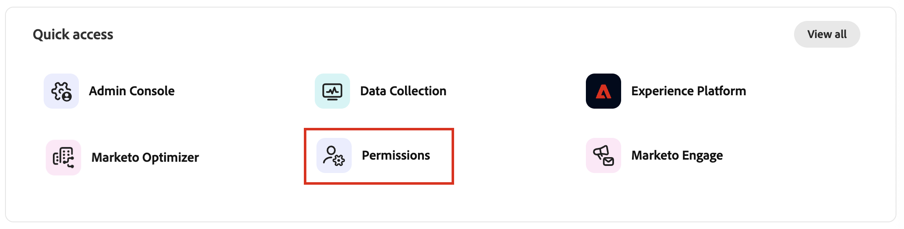

# User access and permissions

After provisioning is complete and sandboxes are bound, complete the following steps to provide [!DNL Marketo Optimizer] access for your team and users.

1. [Create a [!DNL Marketo Optimizer] product profile](#create-profile) in the Admin Console (one-time/initial setup only).
1. [Add a user group](#add-user-group) in the Admin Console.
1. [Assign the product profile](#assign-profile) to the user group in the Admin Console.
1. [Add users to the new group](#add-users) in the Admin Console.
1. [Edit built-in roles](#edit-role-permissions) or [create a custom role](#create-a-custom-role) with product permissions and the required [!DNL Marketo Optimizer] sandbox in Experience Platform.
1. [Add users](#add-users-to-a-role) or [groups](#add-user-groups-to-a-role) to roles in Adobe Experience Platform.

To set up recommended user groups and roles for administrators, all-access users, and read-only users, see [Suggested user types](#suggested-user-types) and [Create user groups and roles for suggested user types](#create-suggested-roles).

## Configure the product profile {#config-profile}

As an administrator, you can complete these tasks in the [!DNL Adobe Admin Console], which is a central place to administer and manage your Adobe product licenses and users. In the Admin Console, you can create and manage users in a single location instead of within your various individual solutions. To learn more about its functions and capabilities, refer to the [Admin Console overview](https://helpx.adobe.com/business/enterprise/deploy-apps-updates.html) page.

### Access the Admin Console {#admin-console}

Before you can use the Admin Console to administer users within your team, you need to ensure that you can access the Admin Console and have the appropriate permissions.

1. As a system administrator, you should receive multiple emails from Adobe as part of the onboarding process.

   Locate the welcome email that provides the information about the organization name to which you have been granted access.

1. Click the **[!UICONTROL Get started]** link in your welcome email to navigate to the Admin Console. 

   If you cannot find the email, open a browser directly to the Admin Console at [https://adminconsole.adobe.com](https://adminconsole.adobe.com).

1. Log in using your Adobe ID.

   Upon successful login, you see the _Overview_ page of the Adobe Admin Console.

1. If you have access to multiple organizations, ensure that you have logged in to the correct organization.

   To change your organization, click the organization name from the top right corner and choose the organization to which you need access.

1. Select **[!UICONTROL Administrators]** from the _[!UICONTROL Users]_ card to verify that you are a system administrator.

   {width="800" zoomable="yes"}

1. Search by entering your Adobe ID email, username, first, or last name.

   * If your access is correctly configured, the search returns your record. 

   * If the value in the **[!UICONTROL ADMIN ROLE]** column shows `System`, you know that you (or the displayed user) are a system administrator.

### Create the [!DNL Marketo Optimizer] product profile {#create-profile}

When granting users access to an Adobe solution, you do not necessarily want to give them full access. Product profiles enable each solution to have its own set of user permissions. Use the Admin Console to assign product profiles.

For more information about using product profiles for user entitlements, see [_Manage product profiles for enterprise users_](https://helpx.adobe.com/business/enterprise/products-entitlements/manage-product-profiles/product-profiles.html){target="_blank"} in the Admin Console documentation.

{width="30"} A system administrator or [!DNL Experience Platform] product administrator can perform the following steps from [https://adminconsole.adobe.com](https://adminconsole.adobe.com).

1. Select the **[!UICONTROL Products]** tab.

1. Open the [!DNL Marketo Optimizer] instance where you want to add the profile and click **[!UICONTROL New profile]**. 

1. Enter a product profile name, such as _Access_.

1. Click **[!UICONTROL Next]** and then **[!UICONTROL Save]**.

### Add a user group {#add-user-group}

A user group is a collection of users who are granted a shared set of permissions. You can add or remove users in your user group. The group permissions remain the same while the users within the group change.

For more information about how user groups are used to manage permissions, see [Manage user groups](https://helpx.adobe.com/business/enterprise/users/users-and-groups/user-groups.html){target="_blank"} in the Admin Console documentation.

{width="30"} A system administrator can perform the following steps from [https://adminconsole.adobe.com](https://adminconsole.adobe.com).

1. Select the **[!UICONTROL Users]** tab.

1. Choose **[!UICONTROL User Groups]** in the left navigation.

1. Click **[!UICONTROL New user group]** at the top right.

1. Enter a name for the user group, such as _Optimizer users_ and click **[!UICONTROL Save]**.

   {width="600" zoomable="yes"} 

### Assign the product profile {#assign-profile}

{width="30"} A product administrator can perform the following steps from [https://adminconsole.adobe.com](https://adminconsole.adobe.com).

1. Click the user group that you created.

1. Select the **[!UICONTROL Assigned product profiles]** tab and click **[!UICONTROL Assign profile]**.

1. Click **+** and add each instance of the following products:

   * [!UICONTROL Adobe Marketo Optimizer - Access]
   * [!UICONTROL Adobe Experience Platform - AEP-Default-All-Users]
   * [!UICONTROL Adobe Experience Platform Data Collection - Default Data Collection All Access]
   * [!UICONTROL Adobe Experience Platform - Default Production All Access]

   {width="600" zoomable="yes"}   

1. Click **[!UICONTROL Save]**.

### Add users to the new group {#add-users}

For information about user management, see [_Adobe Admin Console users_](https://helpx.adobe.com/business/enterprise/users/understand-user-management/user-management-overview.html){target="_blank"} in the Admin Console documentation.

{width="30"} A system administrator or product administrator can perform the following steps from [https://adminconsole.adobe.com](https://adminconsole.adobe.com). A product administrator can add only users that already exist in their organization.

1. If the users are not already members of your organization, add each user:

   * Under _[!UICONTROL Quick links]_, click **[!UICONTROL Add users]**.

   * Enter the user's email address and click **[!UICONTROL Add as new user]**.

      {width="600" zoomable="yes"}
   
   * Enter the first and last name, then click **[!UICONTROL Save]**.

1. Add each user to the group:

   * Click the user name.

   * In the user details page, scroll to **[!UICONTROL User groups]**.
   
   * Click the _More_ ( **...** ) icon on the left and choose **[!UICONTROL Edit user groups]**.

   * Click the _Add_ ( **+** ) icon below **[!UICONTROL User groups]**.

      {width="600" zoomable="yes"}

   * Select the user group that you created previously and click **[!UICONTROL Apply]**.

   * Click **[!UICONTROL Save]** for the user changes.

## Assign product permissions {#assign-product-permissions}

Permissions are unitary rights that allow you to define the authorizations assigned to a product profile. Each permission is grouped under a capability, such as person journeys or content, representing functionalities in [!DNL Marketo Optimizer].

The _Permissions_ area of Adobe Experience Platform is where administrators can define user roles and access policies to manage access permissions for features and objects within a product application. In this app, you can create and manage roles, as well as assign the desired resource permissions for these roles. Permissions also allow you to manage the sandboxes and users associated with a specific role.

For more information about role permissions in Experience Platform, see [Manage permissions for a role](https://experienceleague.adobe.com/en/docs/experience-platform/access-control/abac/permissions-ui/permissions){target="_blank"} in the Experience Platform documentation.

1. Go to [experience.adobe.com](https://experience.adobe.com/).

1. In the _[!UICONTROL Quick access]_ panel, select **[!UICONTROL Permissions]**.

   >[!NOTE]
   >
   >If you don't see _[!UICONTROL Permissions]_, you may need to click **[!UICONTROL View all]** and select it from the available applications.

   {width="700" zoomable="yes"}

### Permission resources {#permissions}

The following permission resources control access to features in [!DNL Marketo Optimizer]. The last three columns show the permissions that are recommended for each of the [suggested user types](#suggested-user-types): Admin, All Access User, and Read Only Access User. A check mark (✔) means that the permission is recommended for that user type, and a dash (–) means that it is not. Adjust the recommendations to fit your organization.

>[!IMPORTANT]
>
>[!DNL Marketo Optimizer] access requires that you enable a specific sandbox that is provisioned using the following naming convention: `Mktoaep` + [!DNL Marketo Engage] subscription prefix. For example, if your linked [!DNL Marketo Engage] subscription prefix is _AcmeAssoc_, the sandbox required for [!DNL Marketo Optimizer] access is _MktoaepAcmeAssoc_. Add this sandbox to every role.

>[!NOTE]
>
>You must be a system administrator to see the _[!UICONTROL Permissions]_ tile in Experience Platform.

Some permissions apply to features that are not yet available in the product. Administrators can add these permissions now so that users have the applicable access when the features become available.

| Category | Permission | Description | Admin | All Access | Read Only |
| -------- | ---------- | ----------- | :---: | :--------: | :-------: |
| B2B Admin Configurations | Manage B2B Admin Configurations | Configure administration settings, such as digital asset management connections, asset repositories, and events. | ✔ | – | – |
| B2B Assets | Manage B2B Assets | Create, edit, and delete asset files. | ✔ | ✔ | – |
| | Manage B2B Emails | Create, edit, and delete email messages. | ✔ | ✔ | – |
| | Manage B2B Forms | Create, edit, and delete forms. | ✔ | ✔ | – |
| | Manage B2B Fragments | Create, edit, and delete content fragments. | ✔ | ✔ | – |
| | Manage B2B Landing Page | Create, edit, and delete landing pages. | ✔ | ✔ | – |
| | Manage B2B Message Export | Export message reports under the _Email_ section. | ✔ | ✔ | – |
| | Manage B2B Templates | Create, edit, and delete content templates. | ✔ | ✔ | – |
| | Manage B2B Webinars | Create, edit, and delete interactive webinars. | ✔ | ✔ | – |
| | Publish B2B Forms | Publish forms for use in landing pages. | ✔ | ✔ | – |
| | Publish B2B Fragments | Publish content fragments for use in templates, emails, and landing pages. | ✔ | ✔ | – |
| | Publish B2B Landing Page | Publish landing pages. | ✔ | ✔ | – |
| | View B2B Assets | View the Assets library and asset file details. | ✔ | ✔ | ✔ |
| | View B2B Emails | View email messages. | ✔ | ✔ | ✔ |
| | View B2B Forms | View forms. | ✔ | ✔ | ✔ |
| | View B2B Fragments | View content fragments list and details. | ✔ | ✔ | ✔ |
| | View B2B Landing Page | View landing pages. | ✔ | ✔ | ✔ |
| | View B2B Templates | View content templates list and details. | ✔ | ✔ | ✔ |
| | View B2B Webinars | View interactive webinars. | ✔ | ✔ | ✔ |
| B2B Channel Configurations | Manage B2B Channels Configurations | Access to the _Channels_ menu item in the left navigation and all channel configuration operations. | ✔ | – | – |
| | Manage B2B Email Settings | Configure email settings. These settings are required before users can send emails. | ✔ | – | – |
| | Manage B2B Forms Preset | Create, edit, and delete form presets. | ✔ | – | – |
| | Manage B2B Landing Page Settings | Configure landing page settings, such as subdomains. | ✔ | – | – |
| | Manage B2B WhatsApp Presets | Create, view, and delete WhatsApp message presets and associated SMS settings. | ✔ | – | – |
| | Manage B2B WhatsApp Settings | Configure WhatsApp channel settings. | ✔ | – | – |
| | Publish B2B Forms Preset | Publish form presets. | ✔ | – | – |
| | View B2B Email Settings | View email settings (subdomains, PTR records, IP pools, suppression lists, seed lists, IP warm-up plans). | ✔ | – | – |
| | View B2B Forms Preset | View form presets. | ✔ | – | – |
| B2B Conversational Experience | Manage B2B Conversational Experience | Access to the chat panel and the assistant. Actions in the panel also require the matching feature permission. For example, creating a journey requires _Manage B2B Person Journeys_. See [Chat permissions](#chat-permissions). | ✔ | ✔ | ✔ |
| B2B Destinations | Activate B2B Destinations | Activate audiences to B2B destinations. | ✔ | ✔ | – |
| | Manage B2B Destinations | Create, edit, and delete B2B destinations. | ✔ | ✔ | – |
| | View B2B Destinations | View-only access to B2B destinations. | ✔ | ✔ | ✔ |
| B2B Folder Tokens | Manage B2B Folder Tokens | Create, edit, and delete tokens on folders. Changes apply to everything in the folder, so assign this separately from _Manage B2B Folders_. | ✔ | ✔ | – |
| | View B2B Folder Tokens | View tokens defined on folders. | ✔ | ✔ | ✔ |
| B2B Folders | Manage B2B Folders | Create, edit, and delete folders. | ✔ | ✔ | – |
| | View B2B Folders | View folders. | ✔ | ✔ | ✔ |
| B2B Intent Configuration | Manage B2B Intent Configuration | Create, edit, and delete intent configurations. | ✔ | ✔ | – |
| | View B2B Intent Configuration | View intent configurations (intent weighting models). | ✔ | ✔ | ✔ |
| B2B Journeys | Manage B2B Journey Traffic Control | Configure journey traffic control, including simulating its effect. | ✔ | ✔ | – |
| | Manage B2B Person Journeys | Access to the _Person Journeys_ list and all person journey operations. | ✔ | ✔ | – |
| | Publish B2B Person Journeys | Publish person journeys. | ✔ | ✔ | – |
| | View B2B Journey Traffic Control | View journey traffic control settings. | ✔ | ✔ | ✔ |
| | View B2B Person Journey Reports | View person journey reports, including the _Person Journey Individual_ report. | ✔ | ✔ | ✔ |
| | View B2B Person Journeys | Read-only access to the _Person Journeys_ list and journey details. | ✔ | ✔ | ✔ |
| B2B Labs | Manage B2B Labs | Enable and configure Labs features. | ✔ | ✔ | – |
| | View B2B Labs | View the Labs features that are available and enabled. | ✔ | ✔ | ✔ |
| B2B Organization Rules | Manage B2B Organization Rules | Create, edit, and delete organization rules. | ✔ | ✔ | – |
| | View B2B Organization Rules | View organization rules. | ✔ | ✔ | ✔ |
| B2B Person Lists | Manage B2B Person Lists | Create, edit, and delete person lists, and manage list membership. | ✔ | ✔ | – |
| | View B2B Person Lists | View static and dynamic person lists. | ✔ | ✔ | ✔ |
| B2B Program Tokens | Manage B2B Program Tokens | Create, edit, and delete tokens on programs and program types. | ✔ | ✔ | – |
| | View B2B Program Tokens | View tokens defined on programs and program types. | ✔ | ✔ | ✔ |
| B2B Program Types | Manage B2B Program Types | Create, edit, and delete marketing program types. | ✔ | – | – |
| | View B2B Program Types | View marketing program types. | ✔ | – | – |
| B2B Programs | Manage B2B Programs | Create, edit, and delete marketing programs. | ✔ | ✔ | – |
| | View B2B Programs | View marketing programs. | ✔ | ✔ | ✔ |
| B2B Reporting | View B2B Embedded Reports | View the reports in the _Reports_ tab. | ✔ | ✔ | ✔ |
| | View B2B Intent Reports | View intent reports. | ✔ | ✔ | ✔ |

#### Chat permissions {#chat-permissions}

Chat permissions follow feature-level permissions. _Manage B2B Conversational Experience_ gives access to the chat panel and the assistant, but it does not grant access to any feature. The assistant checks every skill or action in chat against the same permission that the feature needs outside chat: _Manage_ permissions to create, edit, or publish, and _View_ permissions for read-only skills. If a user lacks the feature permission, the assistant cannot perform that action for them. For example, creating a journey requires _Manage B2B Person Journeys_, and listing forms requires _View B2B Forms_.

#### External destinations permissions {#external-destinations-permissions}

To provide access to external destinations for users in [!DNL Marketo Optimizer], the following permissions are required. The columns follow the same recommendations for each user type described in [Suggested user types](#suggested-user-types).

| Category | Permission | Description | Admin | All Access | Read Only |
| -------- | ---------- | ----------- | :---: | :--------: | :-------: |
| Dashboards | Manage Standard Dashboards | Add custom attributes that are not yet in the data warehouse. | ✔ | ✔ | – |
| | View Standard Dashboards | View-only access to the _Profiles_, _Destinations_, and _Segments_ dashboards. Also enables access to _Dashboards_ in the left navigation. | ✔ | ✔ | ✔ |
| Destinations | Activate Destinations | Activate data to active destinations. _View Destinations_ or _Manage Destinations_ is also required. | ✔ | ✔ | – |
| | Activate Segment without Mapping | Activate audiences to existing destinations without the mapping step. Users can add and remove audiences in activation workflows, but cannot add or remove mapped attributes or identities. _View Destinations_ is also required. | ✔ | ✔ | – |
| | Destination Authoring | Author destinations using the Experience Platform Destination SDK. | ✔ | ✔ | – |
| | Manage and Activate Dataset Destination | View, create, edit, and disable dataset export flows, and activate data to datasets. _View Destinations_ is also required. | ✔ | ✔ | – |
| | Manage Destinations | View, create, and delete destinations connections and destination accounts. | ✔ | ✔ | – |
| | View Destinations | View available destinations in the _Catalog_ tab and authenticated destinations in the _Browse_ tab. | ✔ | ✔ | ✔ |
| Data Governance | Manage B2B Delete Usage Labels | View, create, and delete data usage labels (DULE) applied to datasets and schemas. | ✔ | ✔ | – |
| | Manage Data Usage Policies | View, create, edit, and delete data usage policies. | ✔ | ✔ | – |
| | View Data Usage Policies | View-only access for data usage policies belonging to your organization. | ✔ | ✔ | ✔ |
| Data Ingestion | Manage Sources | View, create, edit, and disable sources. | ✔ | ✔ | – |
| | View Sources | View available sources in the _Catalog_ tab and authenticated sources in the _Browse_ tab. | ✔ | ✔ | ✔ |
| Profile Management | Manage Profile Settings | View and edit all profile settings. | ✔ | ✔ | – |
| | View Profile Settings | View-only access to all profile settings. | ✔ | ✔ | ✔ |

<!-- 

#### Planned permissions {#planned-permissions}

The following permissions are for features that are not yet available in [!DNL Marketo Optimizer]. Adobe Marketo Qualifier permissions are not currently enforced. The estimated enforcement date is November 2026. Accounts and buying groups are targeted for delivery in Q1 2027.

| Category | Permission | Description | Admin | All Access | Read Only |
| -------- | ---------- | ----------- | :---: | :--------: | :-------: |
| Marketo Qualifier Configurations | Manage Marketo Qualifier Configurations | Create, edit, and delete Marketo Qualifier configurations. | ✔ | – | – |
| | View Marketo Qualifier Configurations | View Marketo Qualifier configurations. | ✔ | ✔ | ✔ |
| Marketo Qualifier Outbound | View Marketo Qualifier Outbound | View Marketo Qualifier outbound workflows and outbound reporting. | ✔ | ✔ | ✔ |
| Marketo Qualifier Research | Manage Marketo Qualifier Research | Use and manage research capabilities. | ✔ | ✔ | – |
| | View Marketo Qualifier Research | View research: conversational interface, prospect view, and account and lead research. | ✔ | ✔ | ✔ |
| B2B Account Lists | Manage B2B Account Lists | Create, edit, and delete account lists, including adding, removing, and importing accounts. | ✔ | ✔ | – |
| B2B Buying Groups | Manage B2B Buying Groups | Create, edit, and delete buying groups. | ✔ | ✔ | – |
| | Manage B2B Role Templates | Manage the role templates used in buying groups. | ✔ | ✔ | – |
| | Manage B2B Solution Interests | Manage the solution interests used in buying groups. | ✔ | ✔ | – |
| | Manage B2B Stages | Manage buying group stages. | ✔ | ✔ | – |
| | View B2B Buying Groups | View buying groups. | ✔ | ✔ | ✔ |

-->

### Suggested user types {#suggested-user-types}

Use the permission recommendations in the previous tables as a starting point for the roles that you create. These are suggestions for each type of user. Adjust them to fit your organization.

| Attribute | Admin | All Access User | Read Only Access User |
| --- | ----- | --------------- | --------------------- |
| **Who it is for** | People who set up and manage [!DNL Marketo Optimizer] for your team. | Marketers and operators who work in [!DNL Marketo Optimizer] every day. | People who need to see [!DNL Marketo Optimizer] but not change anything, such as executives, analysts, and auditors. |
| **What they can do** | Everything, including setup and admin settings. | Use every feature: journeys, programs, content, lists, reports, and the assistant. | View journeys, programs, content, lists, and reports, and ask the assistant questions. |
| **Permissions to assign** | Every permission in the previous tables (select **[!UICONTROL Add all]** in the role editor). | The permissions with a ✔ in the _All Access_ column. | The permissions with a ✔ in the _Read Only_ column. |
| **Not included** | – | <li>Admin and channel settings<li>Email settings and WhatsApp presets<li>Data usage labels<li>Creating or changing program types and traffic control<li>Creating destinations, sources, and profile settings | <li>Creating, editing, publishing, or exporting<li>Activating audiences to destinations<li>Admin, channel, and email settings<li>Managing destinations, sources, and profile settings |
| **Suggested user group** | Marketo Optimizer Administrators Group | Marketo Optimizer Users Group | Marketo Optimizer Read Only Users Group |
| **Suggested role** | Marketo Optimizer Administrator | Marketo Optimizer All Access User | Marketo Optimizer Read Only Access User |

For the procedure to create these groups and roles, see [Create user groups and roles for suggested user types](#create-suggested-roles).

<!--

### B2B built-in roles {#b2b-built-in-roles}

When your organization has [!DNL Marketo Optimizer] provisioned, Experience Platform includes a set of built-in (default, read-only) roles that you can use to manage access to the product capabilities:

| Role | Permissions |
| ---- | ----------- |
| B2B Journey Manager | <li>Manage B2B Journeys <li>Manage B2B Buying Groups <li>Manage B2B Account Lists <li>View B2B Engagement Dashboard <li>View B2B Insights Dashboard |
| B2B Channel Manager | <li>Manage B2B Assets <li>Manage B2B Templates <li>Manage B2B Fragments |
| B2B System Administrator | <li>Manage B2B Channels Configurations <li>Manage B2B Admin Configurations |

-->

### Edit role permissions {#edit-role-permissions}

For built-in or custom roles, you can decide at any time to add or delete permissions. If you modify a default or custom role, it impacts every user assigned to the role. 

>[!IMPORTANT]
>
>[!DNL Marketo Optimizer] access requires that you enable a specific sandbox that is provisioned using the following naming convention: `Mktoaep` + [!DNL Marketo Engage] subscription prefix. For example, if your linked [!DNL Marketo Engage] subscription prefix is _AcmeAssoc_, the sandbox required for [!DNL Marketo Optimizer] access is _MktoaepAcmeAssoc_.

>[!NOTE]
>
>A product administrator with access to Experience Platform Permissions can perform these steps.

_To change the permissions for a role:_

1. Select **[!UICONTROL Roles]** in the left navigation.

1. Click the **_Optimizer users_** role name.

1. In the details page, click **[!UICONTROL Edit]** at the top right.

   {width="800" zoomable="yes"}

   In the role editor, the _[!UICONTROL Resources]_ menu displays the list of resources that apply to the Experience Cloud - Platform powered applications.

1. Select the sandbox provisioned for [!DNL Marketo Optimizer] access (`Mktoaep<Marketo subscription prefix>`).

   {width="500" zoomable="yes"}
   
1. Click the _Add_ icon (**+**) for each of the functional resources.

   {width="700" zoomable="yes"}

1. Add the specific permissions for each of the resources, or select **[!UICONTROL Add all]**.

1. Click **[!UICONTROL Save]**.

   <!-- {width="700" zoomable="yes"} -->

1. Click **[!UICONTROL Close]** to return to the details page.

### Add users to a role {#add-users-to-a-role}

{width="30"} A system administrator or Experience Platform administrator can perform the following steps.

1. Open the role details and select the **[!UICONTROL Users]** tab.

   This tab displays a list of all users assigned to the role.

1. Click **[!UICONTROL Add users]**.

   {width="800" zoomable="yes"}

1. In the _[!UICONTROL Add users]_ dialog, locate and select the users that you want to add to the role.

   * You can use the Search tool to filter the list of users. 

   * Select the checkbox for each user.

   {width="600" zoomable="yes"}

1. Click **[!UICONTROL Save]** when you have selected all the users that you want to add.

### Add user groups to a role {#add-user-groups-to-a-role}

For information about user management, see [_Adobe Admin Console users_](https://helpx.adobe.com/business/enterprise/users/understand-user-management/user-management-overview.html){target="_blank"} in the Admin Console documentation.

{width="30"} A system administrator or Experience Platform administrator can perform the following steps.

1. Open the role details and select the **[!UICONTROL User groups]** tab.

   This tab displays a list of all user groups assigned to the role. 

1. Click **[!UICONTROL Add Groups]**.

   {width="800" zoomable="yes"}

1. In the _[!UICONTROL Add groups]_ dialog, locate and select the groups that you want to add to the role.

   * You can use the Search tool to filter the list of user groups. 

   * Select the checkbox for each user group.

   {width="600" zoomable="yes"}

1. Click **[!UICONTROL Save]** when you have selected all the groups that you want to add.

### Create a custom role {#create-a-custom-role}

{width="30"} A system administrator or Experience Platform administrator can perform the following steps.

1. Select **[!UICONTROL Roles]** in the left navigation and select **[!UICONTROL Create role]**.

1. In the _[!UICONTROL Create new role]_ dialog, enter a name for the role, such as _B2B Marketers_, and a description (optional).

1. Click **[!UICONTROL Confirm]**.

1. Select the sandbox provisioned for [!DNL Marketo Optimizer] access (`Mktoaep<Marketo subscription prefix>`).

   {width="500" zoomable="yes"}

1. Add product permissions:

   To determine which product capabilities you want for the role, refer to the list of [product permissions](#permissions).

   In the _[!UICONTROL Resources]_ list on the left, locate the B2B items and click the _Add_ (**+**) icon to add each attribute that you want to enable for the role.

   You can enter _B2B_ in the search tool to filter the list for many of the B2B-related product permissions that apply to [!DNL Marketo Optimizer].

   {width="700" zoomable="yes"}   

1. Click **[!UICONTROL Save]** at the top right.

1. Go to the role details and select the **[!UICONTROL User groups]** tab.

1. Click **[!UICONTROL Add Groups]**.

1. Select the checkbox next to the user group that you created previously in the Admin Console.

1. Click **[!UICONTROL Save]**.

Your custom role is configured and users in the assigned group can now access the [!DNL Marketo Optimizer] capabilities you selected.

### Create user groups and roles for suggested user types {#create-suggested-roles}

Use the following procedures to set up the Admin, All Access User, and Read Only Access User [suggested user types](#suggested-user-types). For each user type, you create a user group in the Admin Console and a role in Experience Platform, and then add the group to the role.

#### Create the Admin user group and role {#create-admin-group}

{width="30"} A system administrator can perform the following steps.

1. In the Admin Console, [add a user group](#add-user-group) named _Marketo Optimizer Administrators Group_, and [assign the product profile](#assign-profile) to it.

1. Add the users who set up and manage [!DNL Marketo Optimizer] to the group.

1. Make the users product administrators so they can manage users and groups.

1. In Experience Platform Permissions, select **[!UICONTROL Roles]** > **[!UICONTROL Create role]**, enter the name _Marketo Optimizer Administrator_, and click **[!UICONTROL Confirm]**.

1. Select the sandbox provisioned for [!DNL Marketo Optimizer] access (`Mktoaep<Marketo subscription prefix>`).

   >[!IMPORTANT]
   >
   >This step is critical for proper access.

1. For each of the following categories, click the _Add_ (**+**) icon and select **[!UICONTROL Add all]**:

   * B2B Admin Configurations
   * B2B Assets
   * B2B Channel Configurations
   * B2B Conversational Experience
   * B2B Destinations
   * B2B Folder Tokens
   * B2B Folders
   * B2B Intent Configuration
   * B2B Journeys
   * B2B Labs
   * B2B Organization Rules
   * B2B Person Lists
   * B2B Program Tokens
   * B2B Program Types
   * B2B Programs
   * B2B Reporting
   * Dashboards
   * Destinations
   * Data Governance
   * Data Ingestion
   * Profile Management

   >[!TIP]
   >
   >Use **[!UICONTROL Add all]** for the Admin role only. When new features are released, the permissions that were prepared for them are applied to the Admin role automatically, so you do not need to edit the role. For the other user types, select only the permissions that are marked with a check mark (✔) for that type.

1. Click **[!UICONTROL Save]**.

1. In the role details, select the **[!UICONTROL User groups]** tab, click **[!UICONTROL Add Groups]**, select _Marketo Optimizer Administrators Group_, and click **[!UICONTROL Save]**.

#### Create the All Access User group and role {#create-all-access-group}

{width="30"} A system administrator can perform the following steps.

1. In the Admin Console, [add a user group](#add-user-group) named _Marketo Optimizer Users Group_, [assign the product profile](#assign-profile) to it, and [add users](#add-users) to the group.

1. In Experience Platform Permissions, [create a custom role](#create-a-custom-role) named _Marketo Optimizer All Access User_.

1. Select the sandbox provisioned for [!DNL Marketo Optimizer] access (`Mktoaep<Marketo subscription prefix>`).

1. For each category in the [permission tables](#permissions), click the _Add_ (**+**) icon and select only the permissions with a ✔ in the _All Access_ column.

   All Access Users can work in every feature day to day, but they do not receive admin, channel, or setup permissions.

1. Click **[!UICONTROL Save]**.

1. In the role details, select the **[!UICONTROL User groups]** tab, click **[!UICONTROL Add Groups]**, select _Marketo Optimizer Users Group_, and click **[!UICONTROL Save]**.

#### Create the Read Only Access User group and role {#create-read-only-group}

{width="30"} A system administrator can perform the following steps.

1. In the Admin Console, [add a user group](#add-user-group) named _Marketo Optimizer Read Only Users Group_, [assign the product profile](#assign-profile) to it, and [add users](#add-users) to the group.

1. In Experience Platform Permissions, [create a custom role](#create-a-custom-role) named _Marketo Optimizer Read Only Access User_.

1. Select the sandbox provisioned for [!DNL Marketo Optimizer] access (`Mktoaep<Marketo subscription prefix>`).

1. For each category in the [permission tables](#permissions), click the _Add_ (**+**) icon and select only the permissions with a ✔ in the _Read Only_ column.

   Read Only Access Users can only view features.

1. Click **[!UICONTROL Save]**.

1. In the role details, select the **[!UICONTROL User groups]** tab, click **[!UICONTROL Add Groups]**, select _Marketo Optimizer Read Only Users Group_, and click **[!UICONTROL Save]**.
